


### i get bored easily, so i do research.

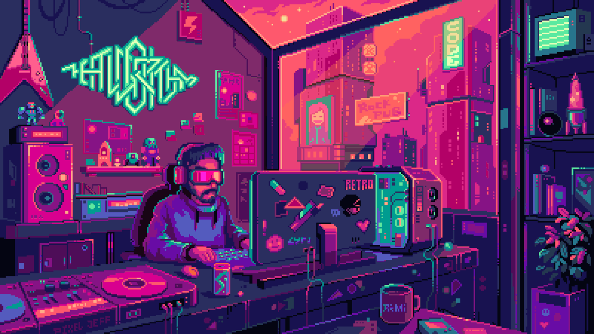

*the vibe, basically · pixel art by Pixel Jeff*


## `// right now`

- **computer vision research engineer @ [Metafusion](https://www.metafusion.ai/)**: teaching cameras to notice trains, trespassers and potholes.
- my train detector runs on **~30 edge devices** at Pune Metro. the one at New Delhi Railway Station raised **141 alerts in live testing, zero false alarms**.
- built **Scene Search** at NDLS: type what you're looking for, get the CCTV moment back in **~60 ms**.
- **M.Tech in AI, IIT Jodhpur.** my thesis on singing deepfakes is **under review at AAAI 2027**.
- AWS Certified Solutions Architect. occasionally writes things on [Medium](https://medium.com/@jyotishmandas85p).

## `// things i built`

  <a href="https://github.com/rishi02102017/QPAudioEraser-IndiaAI-Impact-Summit-Demo"></a>
  <a href="https://github.com/rishi02102017/HalluciDetect"></a>

  <a href="https://github.com/rishi02102017/PersonVLM"></a>
  <a href="https://github.com/rishi02102017/The-Aerial-Guardian-Challenge"></a>

  <a href="https://github.com/rishi02102017/swift-llm"></a>
  <a href="https://github.com/rishi02102017/Tradl-AI-Hackathon"></a>

<a href="https://github.com/rishi02102017?tab=repositories">more experiments in the repos →</a>

## `// research`

- **singing deepfakes, 37 languages.** a benchmark of 530K+ clips (2,500+ hours); 13 detectors tested, best EER 0.20%. *under review at AAAI 2027.*
- **machine unlearning for vision + audio.** removes identities from trained models 10–20× faster than 7 state-of-the-art baselines.
- **interpretable deepfake detection under domain shift.** took near-chance detectors to 97–99.6% average AUC across 7 public benchmarks. *manuscript in preparation.*

## `// stack`

  

also on the bench: vLLM · Qwen3-VL · YOLO · RT-DETR · TensorRT · ONNX · Milvus · LangGraph · MLflow · PySpark · Airflow

## `// wins`

- 🏆 **3× hackathon winner**: [Tradl AI](https://github.com/rishi02102017/Tradl-AI-Hackathon) (LangGraph multi-agent news intelligence, 96% dedup accuracy), [Darwix AI](https://github.com/rishi02102017/Darwix-AI-Hackathon), [Crowdera Hack4RealGood](https://github.com/rishi02102017/EventHub-Old)
- 🎤 picked to demo **QPAudioEraser** at the **IndiaAI Impact Summit 2026** (MeitY)
- ⭐ **A\*** in Generative AI & Foundation Models: the only one in the course to score 90+ in every evaluation
- 🏅 **5th** at HackRush (IIT Jodhpur × HackerRank) · **top 5** at CLASH-OF-T-AI-TANS (computer vision)

## `// contributions, but make it 3d`


<picture>
  <source media="(prefers-color-scheme: dark)" srcset="https://raw.githubusercontent.com/rishi02102017/rishi02102017/output/github-contribution-grid-snake-dark.svg" />
  <source media="(prefers-color-scheme: light)" srcset="https://raw.githubusercontent.com/rishi02102017/rishi02102017/output/github-contribution-grid-snake.svg" />
  
</picture>

*01:17. still training.*

## `// say hi`

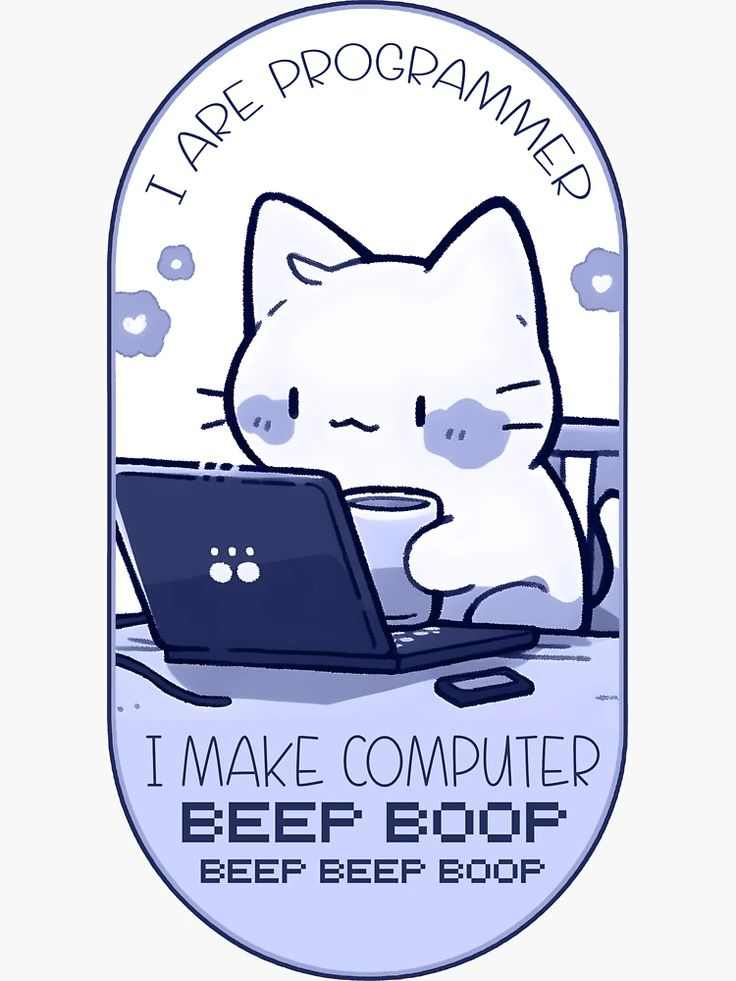

**beep boop.** if it involves cameras, deepfakes, or models that have to run on tiny hardware, i'm in.

[LinkedIn](https://www.linkedin.com/in/jyotishmandas85p/) · [Portfolio](https://jyotishman-portfolio.vercel.app/) · [Medium](https://medium.com/@jyotishmandas85p) · [Email](mailto:jyotishmandas85p@gmail.com)

hand-made svgs · no templates were harmed · last updated october 2026

